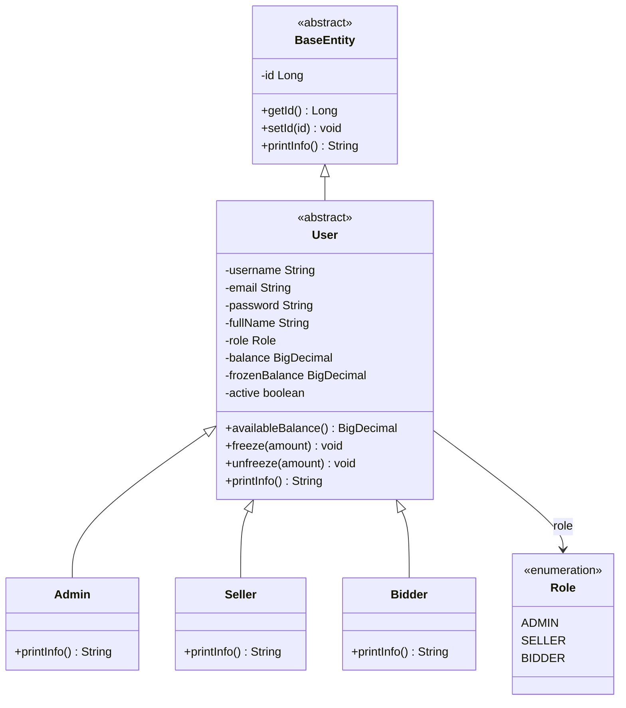
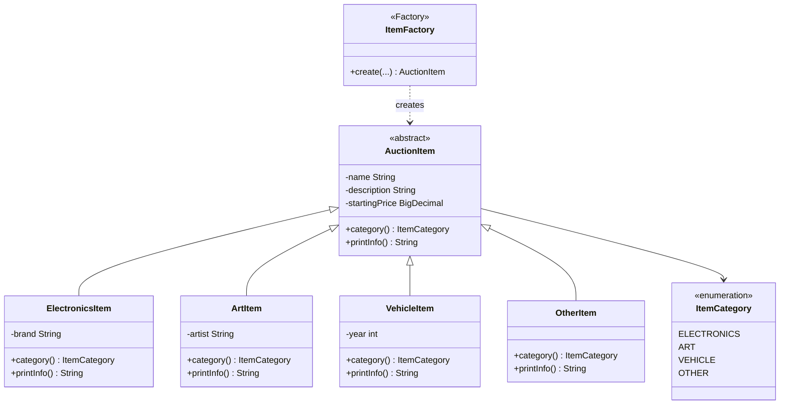
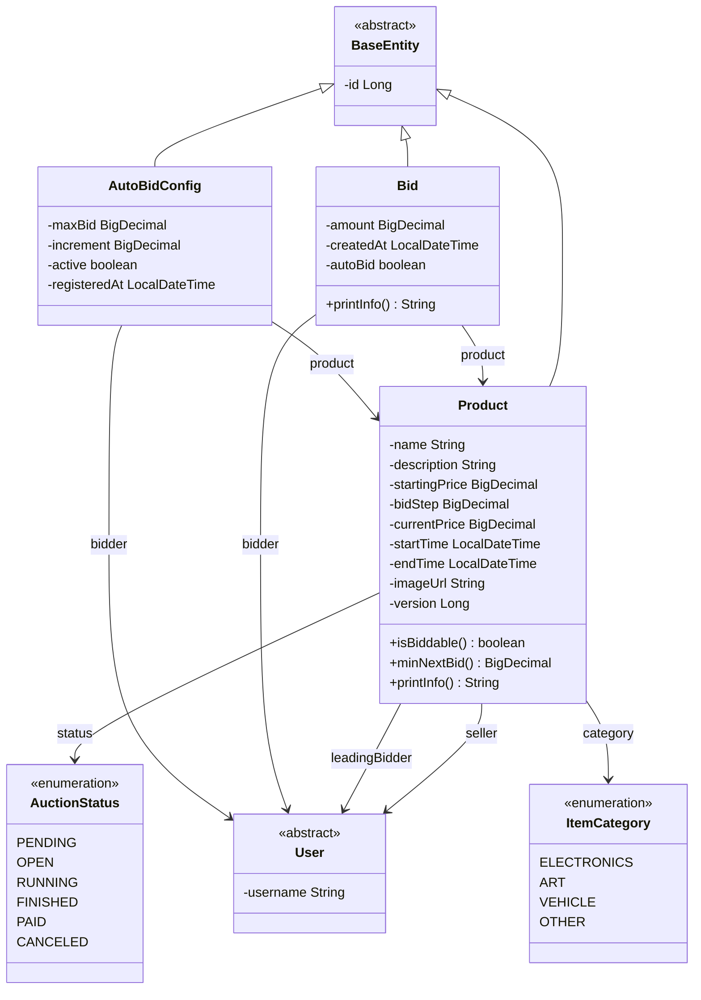
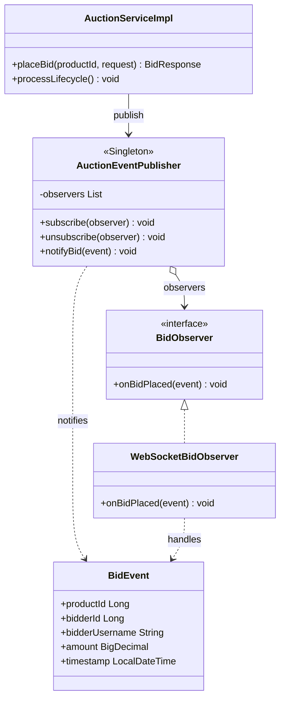
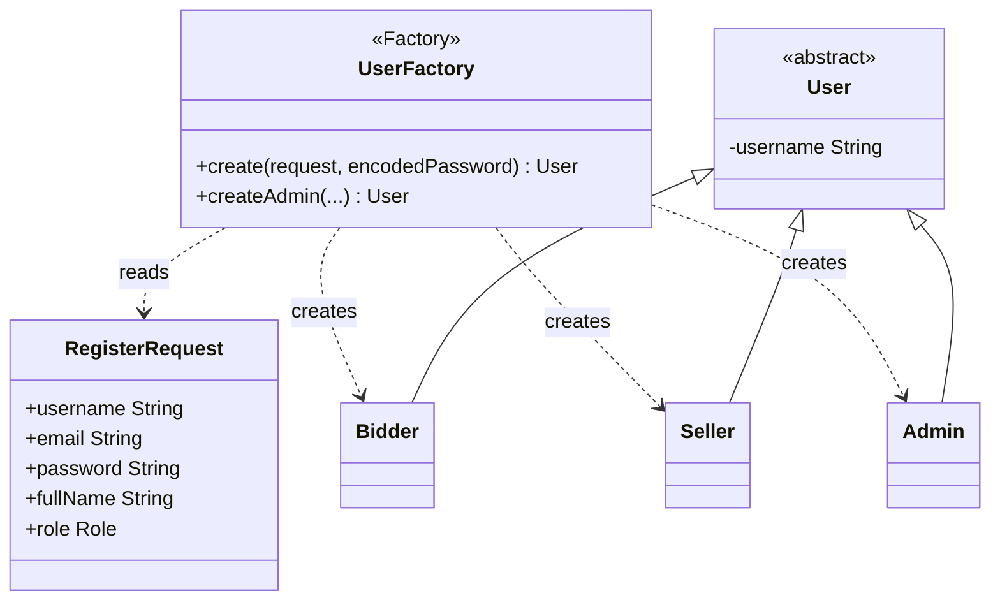
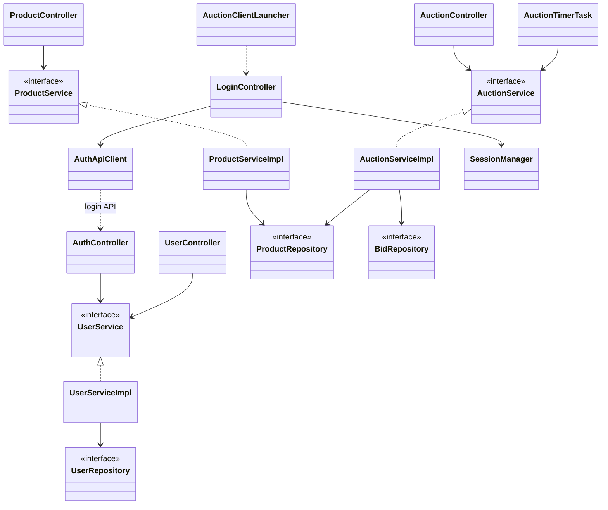

# Class Diagrams — Tuần 6 (OOP & Design Patterns)

Bám **Tuần 6** (*Hướng dẫn BTL LTNC-2026*):

> `User` (abstract) → `Bidder` / `Seller` / `Admin`  
> `Item` (abstract) → `Electronics` / `Art` / `Vehicle`  
> `Auction`, `Bid` + Singleton + Factory Method

Diagram phản ánh code hiện tại GROUP-6-BTL.

---

## 1. Cây kế thừa User

JPA: `SINGLE_TABLE` + `@DiscriminatorColumn(user_type)`.

---

## 2. Cây kế thừa Item + Factory Method

---

## 3. Auction / Product / Bid

Đề: `Auction` + `Bid`. Repo: entity `Product` = phiên đấu giá.

Trạng thái: `PENDING → OPEN → RUNNING → FINISHED → PAID / CANCELED`

---

## 4. Singleton + Observer (AuctionManager)

---

## 5. Factory tạo User theo Role

---

## 6. Kiến trúc phân tầng (Server + JavaFX Client)

---

## 7. Mapping đề Tuần 6 ↔ class trong repo

| Gợi ý đề (Tuần 6) | Class trong project |
| --- | --- |
| `User` (abstract) | `model.entity.User` |
| `Bidder` / `Seller` / `Admin` | `Bidder`, `Seller`, `Admin` |
| `Item` (abstract) | `model.item.AuctionItem` |
| `Electronics` / `Art` / `Vehicle` | `ElectronicsItem`, `ArtItem`, `VehicleItem` |
| `Auction` | `model.entity.Product` (+ `AuctionStatus`) |
| `Bid` | `model.entity.Bid` |
| Singleton `AuctionManager` | `observer.AuctionEventPublisher` |
| Factory Method tạo Item | `factory.ItemFactory` |
| Factory User | `service.impl.UserFactory` |
| Observer | `BidObserver`, `WebSocketBidObserver`, `BidEvent` |

---

## Checklist Tuần 6

- [x] Class diagram User / Item / Auction / Bid
- [x] OOP abstract + `printInfo()`
- [x] Factory Method (`ItemFactory`)
- [x] Singleton subject (`AuctionEventPublisher`)
- [ ] Export ảnh Mermaid cho slide báo cáo
