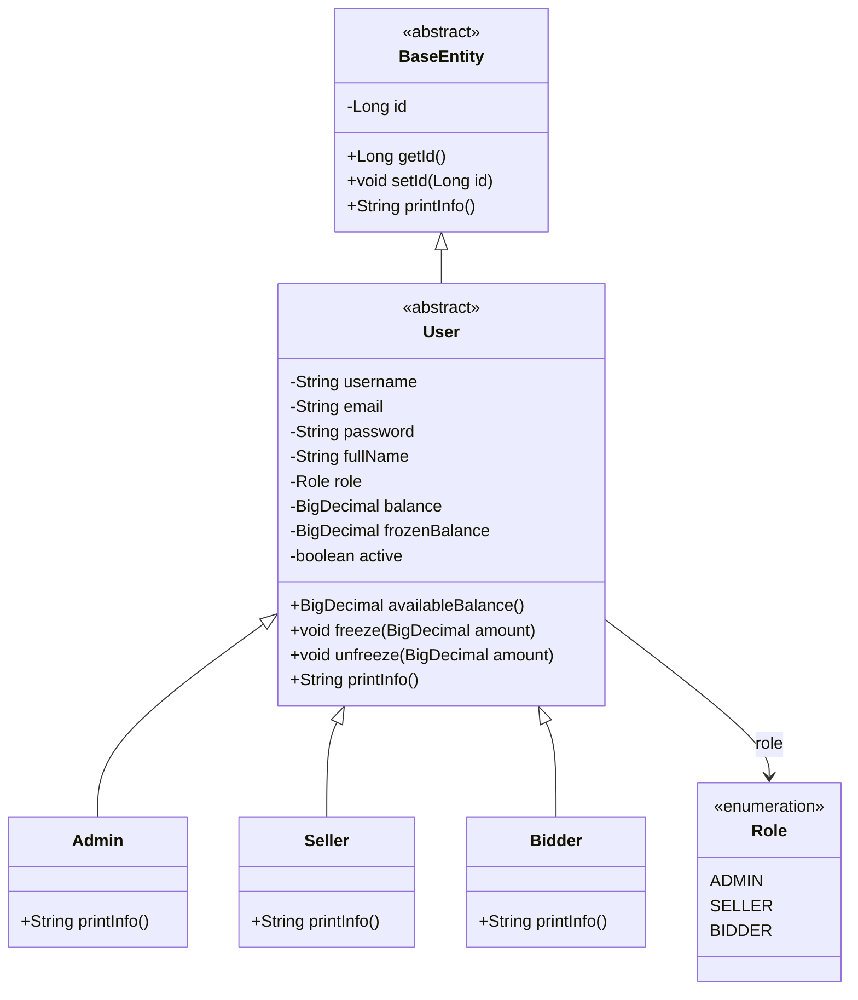
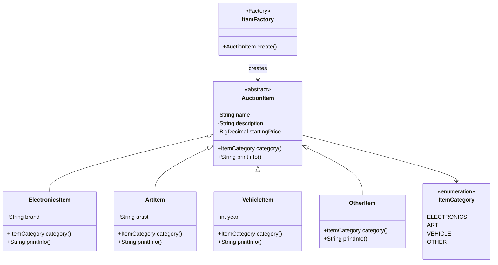
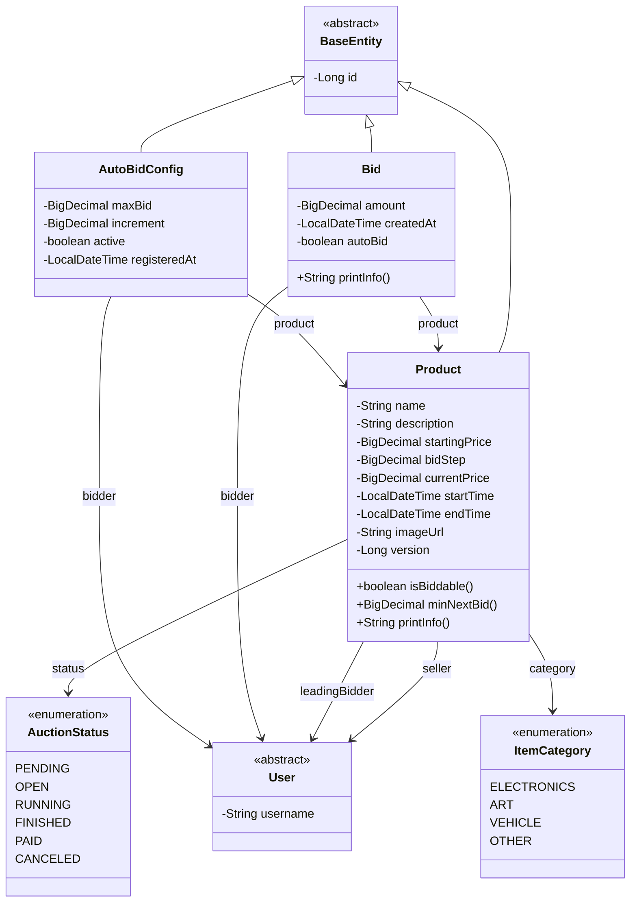
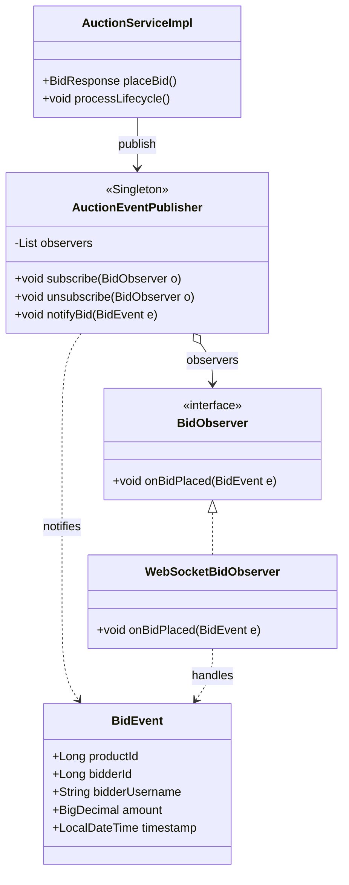
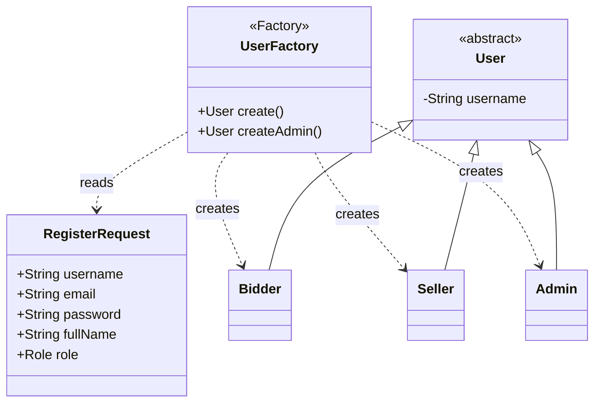

# Class Diagrams — Online Auction (GROUP-6-BTL)

Theo **Tuần 6** (*Hướng dẫn BTL LTNC-2026*): cây kế thừa OOP + Singleton + Factory.

Mở file này trên **GitHub** để Mermaid render sơ đồ.

---

## 1. User hierarchy

---

## 2. Item hierarchy + Factory Method

---

## 3. Product (Auction) / Bid / AutoBid

Status flow: `PENDING → OPEN → RUNNING → FINISHED → PAID / CANCELED`

---

## 4. Singleton + Observer (AuctionManager)

---

## 5. UserFactory

---

## 6. Layer architecture (Server + JavaFX)

---

## Mapping đề ↔ code

| Đề Tuần 6 | Class trong project |
| --- | --- |
| User (abstract) | `model.entity.User` |
| Bidder / Seller / Admin | `Bidder`, `Seller`, `Admin` |
| Item (abstract) | `model.item.AuctionItem` |
| Electronics / Art / Vehicle | `ElectronicsItem`, `ArtItem`, `VehicleItem` |
| Auction | `model.entity.Product` |
| Bid | `model.entity.Bid` |
| AuctionManager (Singleton) | `AuctionEventPublisher` |
| Factory Method Item | `ItemFactory` |
| Observer | `BidObserver`, `WebSocketBidObserver` |
