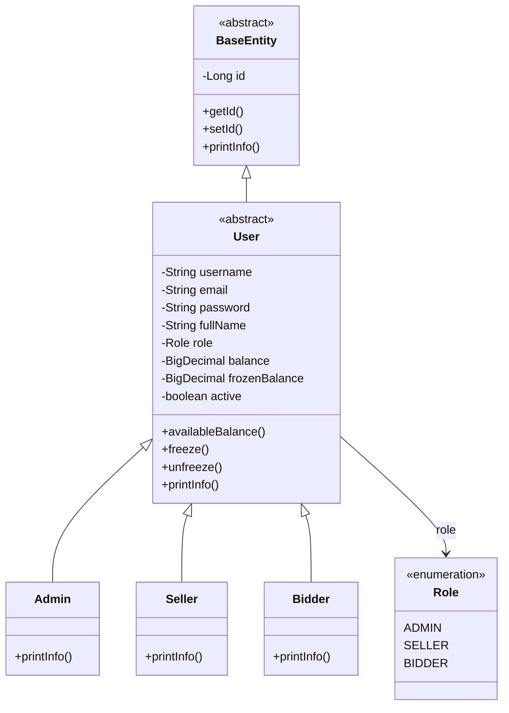
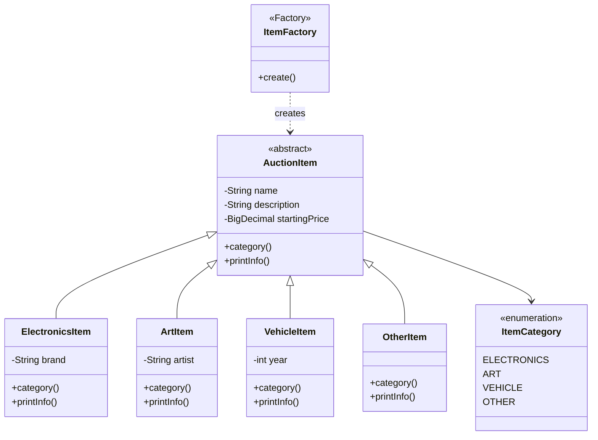
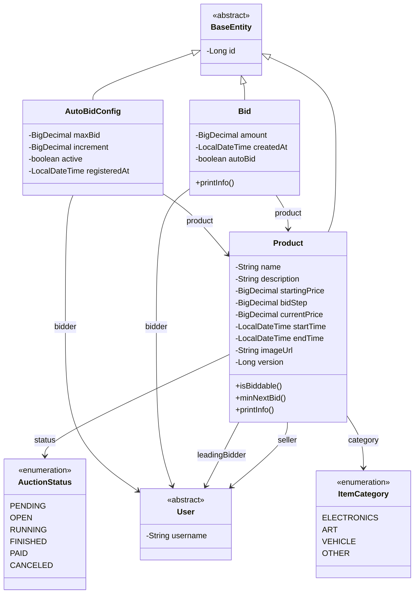
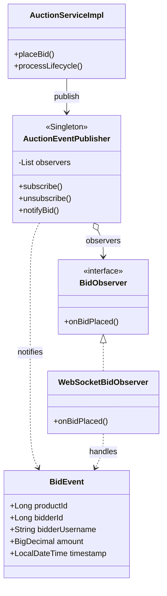
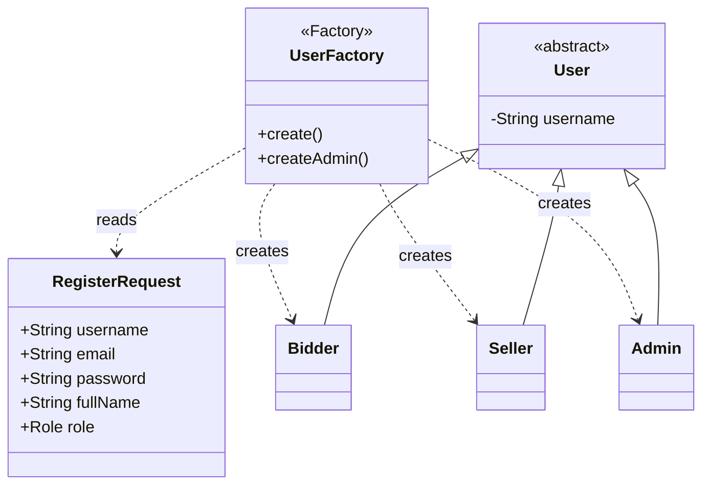
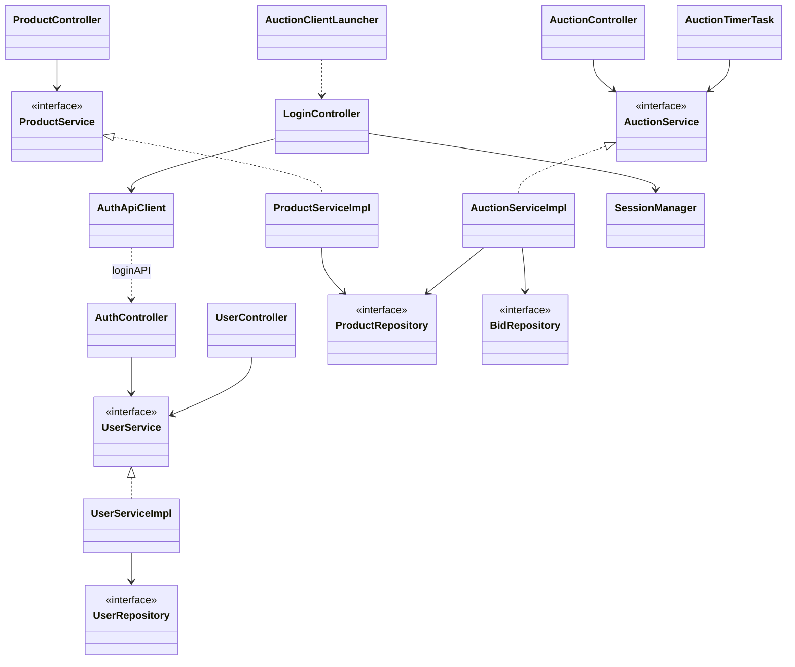

# Class Diagrams — Online Auction (GROUP-6-BTL)

Theo Tuần 6 (Huong dan BTL LTNC-2026): cay ke thua OOP + Singleton + Factory.

Mo file nay tren github.com sau khi **commit + push** ban moi nhat.

---

## 1. User hierarchy

---

## 2. Item hierarchy + Factory Method

---

## 3. Product / Bid / AutoBid

Status: PENDING to OPEN to RUNNING to FINISHED to PAID or CANCELED

---

## 4. Singleton + Observer

---

## 5. UserFactory

---

## 6. Layer architecture

---

## Mapping de vs code

| De Tuan 6 | Class trong project |
| --- | --- |
| User abstract | model.entity.User |
| Bidder / Seller / Admin | Bidder, Seller, Admin |
| Item abstract | model.item.AuctionItem |
| Electronics / Art / Vehicle | ElectronicsItem, ArtItem, VehicleItem |
| Auction | model.entity.Product |
| Bid | model.entity.Bid |
| AuctionManager Singleton | AuctionEventPublisher |
| Factory Method Item | ItemFactory |
| Observer | BidObserver, WebSocketBidObserver |
