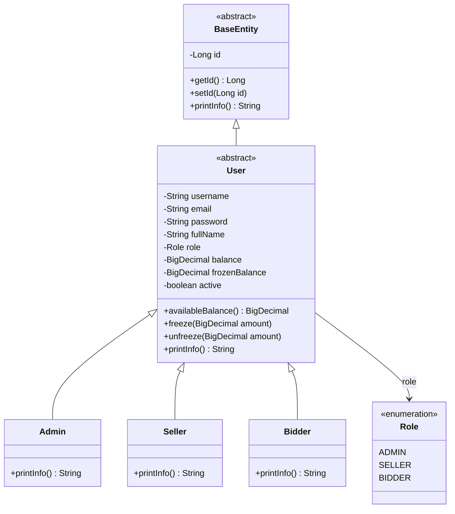
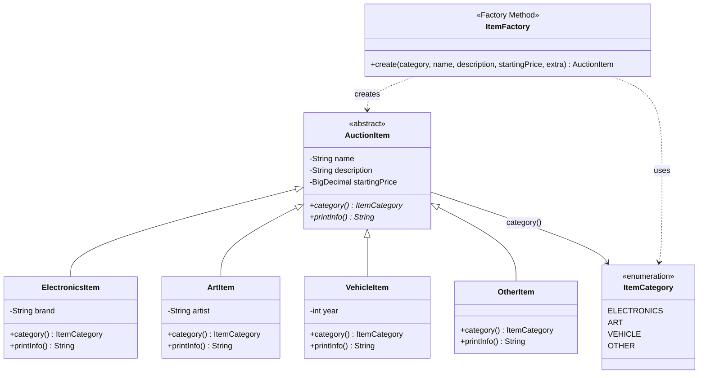
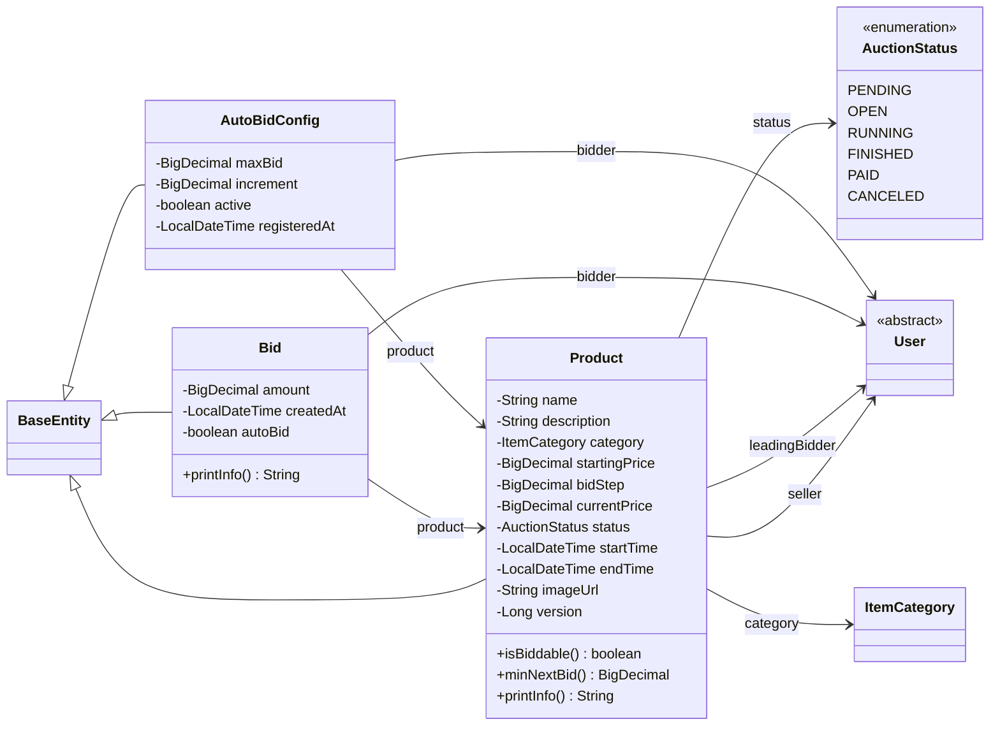
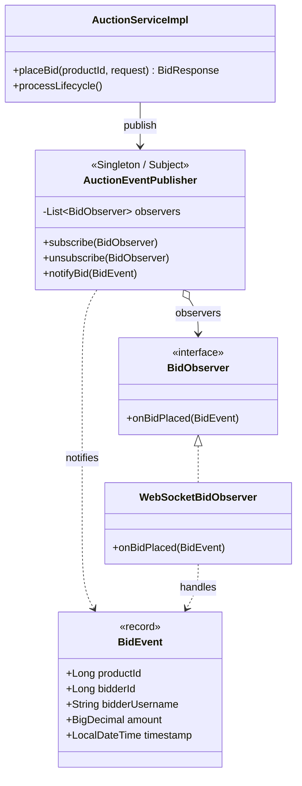
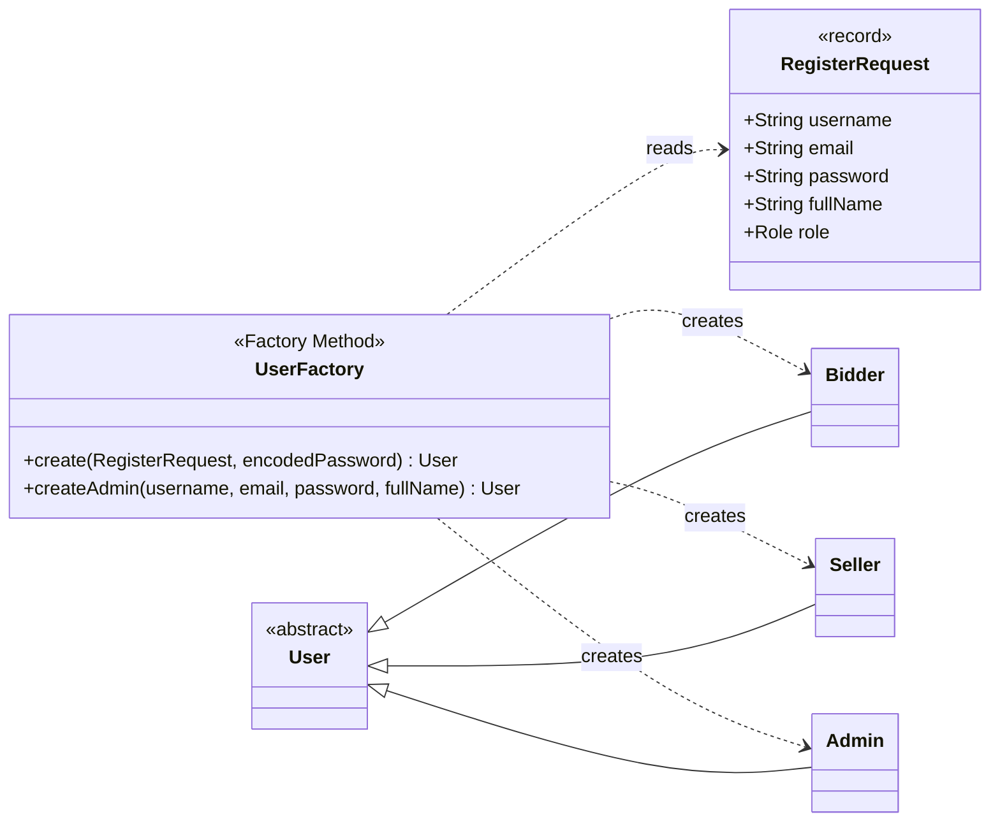
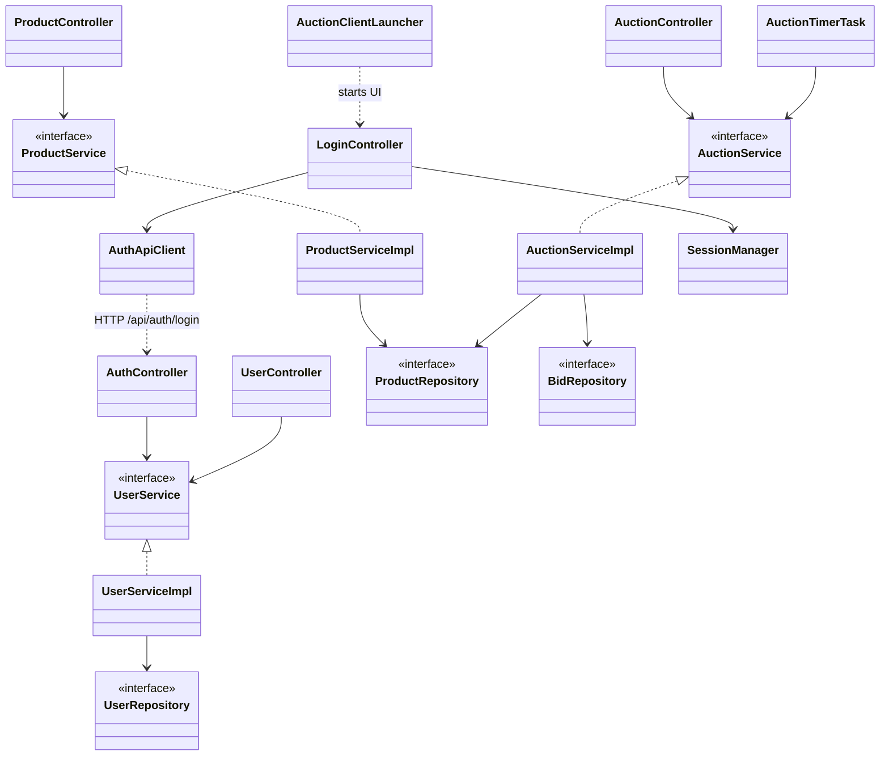

# Class Diagrams — Tuần 6 (Thiết kế OOP & Design Patterns)

Tài liệu này bám **Tuần 6** trong *Hướng dẫn BTL LTNC-2026*:

> Thiết kế sơ đồ lớp: `User` (abstract) → `Bidder` / `Seller` / `Admin`;  
> `Item` (abstract) → `Electronics` / `Art` / `Vehicle`; `Auction`, `Bid`;  
> Singleton (`AuctionManager`) + Factory Method (tạo Item).

Các diagram dưới đây phản ánh **code hiện tại** của GROUP-6-BTL (Spring Boot server + JavaFX client).

---

## 1. Cây kế thừa User (OOP — Abstraction / Inheritance)

**Ghi chú:** JPA `SINGLE_TABLE` + `@DiscriminatorColumn(user_type)`.

---

## 2. Cây kế thừa Item + Factory Method (Tuần 6)

Theo đề: `Item` abstract → `Electronics` / `Art` / `Vehicle`.  
Trong project: domain class `AuctionItem` (không map JPA) + `ItemFactory`.

---

## 3. Auction / Product / Bid (nghiệp vụ đấu giá)

Đề gọi `Auction` + `Bid`. Project lưu phiên đấu giá trong entity `Product` (kèm trạng thái, giá, thời gian) và lịch sử `Bid`.

**Luồng trạng thái (Tuần 7 gợi ý, đã dựng base):**  
`PENDING → OPEN → RUNNING → FINISHED → PAID / CANCELED`

---

## 4. Design Patterns — Singleton + Observer (gợi ý AuctionManager)

Tuần 6: Singleton quản lý đấu giá.  
Tuần 7: Observer notify bid mới.  
Trong code: `AuctionEventPublisher` (Spring singleton bean) đóng vai **AuctionManager / Subject**.

---

## 5. Factory tạo User theo Role

Bổ sung song song `ItemFactory` (đúng tinh thần Factory Method Tuần 6).

---

## 6. Kiến trúc phân tầng (Server MVC-ish + Client)

Không bắt buộc Tuần 6 nhưng giúp nhóm nhìn toàn hệ thống khi mở rộng Tuần 7–10.

---

## 7. Mapping đề Tuần 6 ↔ class trong repo

| Gợi ý đề (Tuần 6) | Class trong project |
| --- | --- |
| `User` (abstract) | `model.entity.User` |
| `Bidder` / `Seller` / `Admin` | `Bidder`, `Seller`, `Admin` |
| `Item` (abstract) | `model.item.AuctionItem` |
| `Electronics` / `Art` / `Vehicle` | `ElectronicsItem`, `ArtItem`, `VehicleItem` |
| `Auction` | `model.entity.Product` (+ `AuctionStatus`) |
| `Bid` | `model.entity.Bid` |
| Singleton `AuctionManager` | `observer.AuctionEventPublisher` (+ `AuctionServiceImpl`) |
| Factory Method tạo Item | `factory.ItemFactory` |
| (mở rộng) Factory User | `service.impl.UserFactory` |
| Observer (Tuần 7) | `BidObserver`, `WebSocketBidObserver`, `BidEvent` |

---

## Cách xem diagram

- GitHub / GitLab: render Mermaid trong Markdown tự động.
- VS Code / Cursor: mở file này + extension Mermaid preview.
- Export ảnh: paste block Mermaid vào [mermaid.live](https://mermaid.live).

---

## Việc Tuần 6 còn cần làm (checklist)

- [x] Class diagram User / Item / Auction / Bid
- [x] OOP: abstract + override `printInfo()`
- [x] Factory Method (`ItemFactory`)
- [x] Singleton subject (`AuctionEventPublisher`)
- [ ] Bổ sung slide/ảnh export từ Mermaid cho báo cáo
- [ ] Mỗi thành viên giải thích được cây kế thừa + pattern trên diagram
